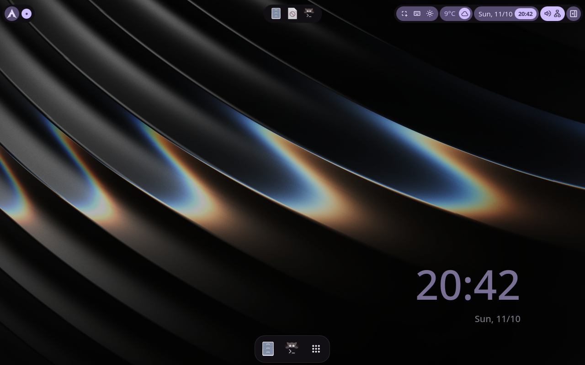
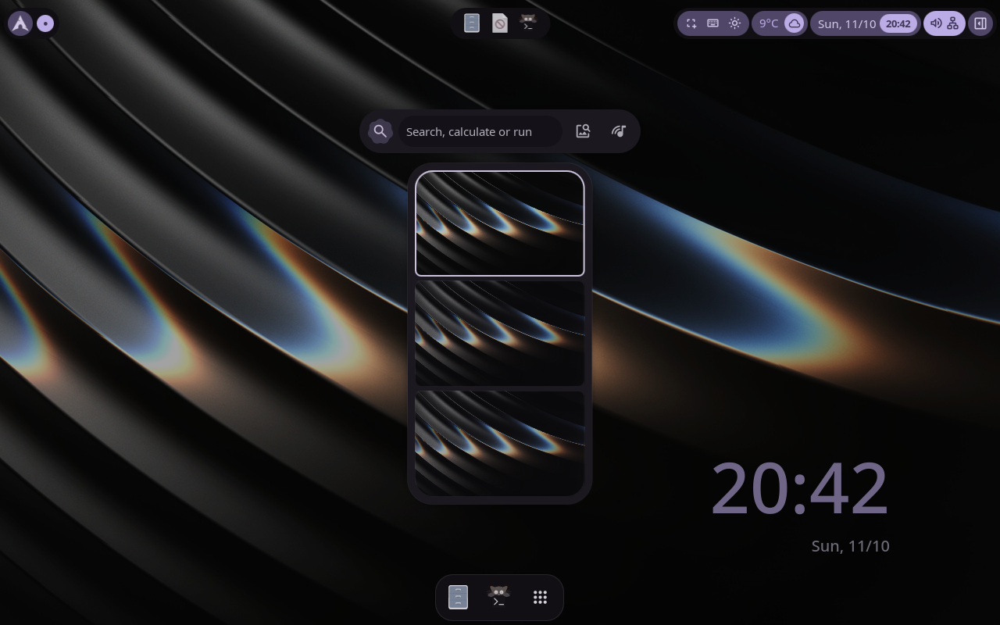
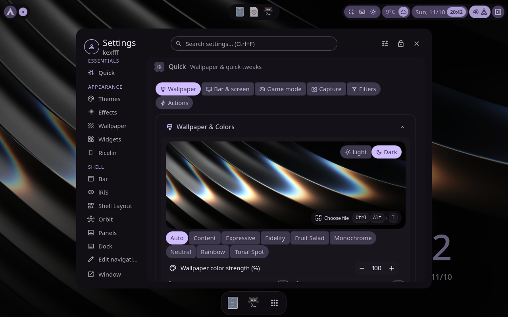
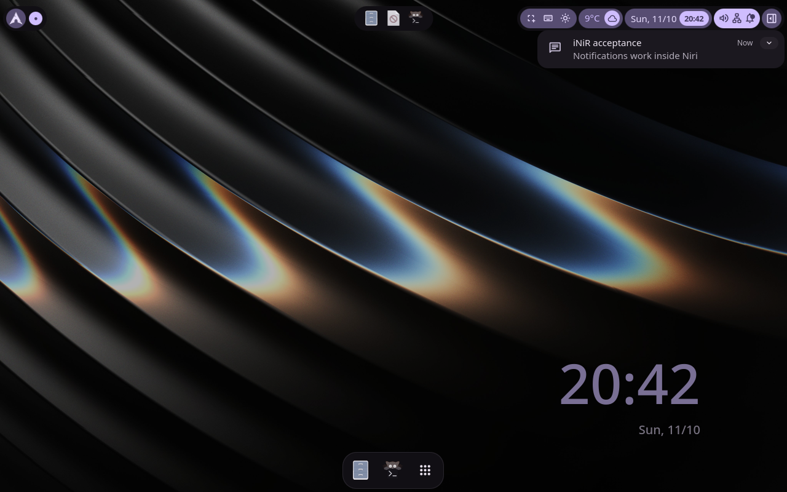
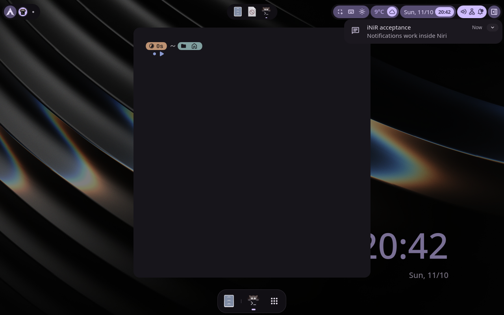

# iNiR: установка и настоящая графическая сессия

Проверено на `Looom-feedback-limine`, MAC `52:54:00:10:10:11`,
4 vCPU / 4 GiB / Virtio 64 GiB, UEFI/Limine. Все сборки, запуск установщика,
проверки QML и функциональные тесты выполнены внутри этой VM.
На хосте — редактирование, передача файлов и управление консолью/libvirt.

Итог: `inir-desktop-v2` подтверждён и выбран постоянным релизом.
Ядро `7.2.9-arch1-1`, корень `@root-inir-desktop-v2` read-only.
`looom verify` проверил ядро, mounts, units, accounts, exact package inventory
и native manager. Системный snapshot `2026-10-07`, closure **924 signed packages**.
Пользователь `kexfff`; учётные данные сохранены, приватные backups не публиковались.

## Входы и установка

- iNiR 2.33.0, commit `48cdcecb0f6089cfbb7019054602eab28e154b3b`.
- [Переносимый профиль и инструкция](../../../examples/inir/README.md).
- [Проверенная декларация](base.yaml), [пакетный список](inir-packages.yaml),
  [системный lock](base.lock). Декларация ссылается только на имена существующих
  password secrets; значений паролей здесь нет.
- Список системных пакетов получен из upstream Arch PKGBUILD-групп.
  Требуемые repository packages включены в декларацию одним списком;
  контейнерный AUR/helper и сторонние repositories не переносились на хост.
- Source склонирован обычным пользователем в `~/looom/inir-20261011/source`.
  Файловая установка выполнялась с `--skip-deps --skip-setups`.
  Python 3.12.15 и 31 Python dependency закреплены в переносимом профиле.
- Upstream патч для read-only системы отключает системную тему SDDM,
  host pacman update detection и изменяющие host-пакеты действия меню.
  Последние выводят пояснение о looom вместо выполнения legacy-команды.
- iNiR установлен в `~/.config/quickshell/inir`; config — `~/.config/inir/config.json`,
  Niri — `~/.config/niri/config.kdl` и `config.d/`.
  User service `inir.service` подключён к `niri.service`, а не к общему desktop target.
- Переносимый пользовательский профиль: Noto Sans, Papirus, меньшие эффекты,
  Breeze вместо AUR Darkly, отключённые автообновление iNiR и пакетные search actions.
  Upstream-фаза меняет также GTK/KDE, terminal configs и shell profiles;
  перед каждым запуском сделана частная резервная копия.

Системная декларация для дальнейших пересборок на этой VM:
`/home/kexfff/looom/inir-20261011/declaration/base.yaml`.
Исходный `~/looom/base.yaml` оставлен как прежний профиль; для сохранения iNiR
при дальнейшей сборке используйте декларацию выше.

## Исправление графики VM

Исходная VM не предоставляла VirGL. Niri стартовал без outputs, в журнале
были `software EGL renderers are skipped` и `no allocator available for device`.
Только включить `accel3d` оказалось недостаточно: XML принудительно закреплял
`device='virtio-vga'`. Этот атрибут убран; фактическая модель стала `virtio-vga-gl`.
SPICE использует локальное подключение и OpenGL на host render node.
В guest kernel после этого появились `+virgl` и `+context_init` ([gpu.log](gpu.log)).

В графическом входе Breeze на этой VM проявилась отдельная проблема отрисовки.
Диагностический runtime override проверен и затем заменён декларативным
`/etc/sddm.conf.d/90-inir-software-greeter.conf`:

```ini
[General]
GreeterEnvironment=QT_QUICK_BACKEND=software
```

Программная отрисовка применяется только к greeter. Настройка включена в последний
релиз; после перезагрузки временного override в `/run` уже нет.
Niri и Quickshell запускаются в настоящей SDDM-сессии на seat0/tty1,
Niri предоставляет работающий `Virtual-1` 1280×800. Это полноценный вход,
не nested compositor и не тестовое окно вместо iNiR.

## Проверки и доказательства

[Функциональный тест](../../../scripts/test-inir-session.py) проверяет:

1. Настоящую seat0-сессию, активные Niri/iNiR и рабочий output.
2. Синтаксис двух адаптированных QML services штатным `qmlformat`.
3. Реальный shell guard из пакетного service: legacy-действие с безвредным
   sentinel не выполняется, выводится пояснение о looom.
4. IPC полного iNiR, открытие overview и settings overlay.
5. Копирование/чтение текста и сохранение его штатным clipboard watcher в cliphist.
6. Уведомление и отображение его в оболочке.
7. Запуск штатного терминала через `inir terminal`, окно kitty в Niri IPC.
8. Перезапуск user service, смену PID и повторную доступность IPC.

Итоги: [result.json](result.json), [acceptance.log](acceptance.log),
[outputs.json](outputs.json), [windows.json](windows.json), [IPC](ipc.txt),
[package guard](package-guard.log), [service.log](service.log).
`NRestarts=0` после проверки; журнал не содержал TypeError/ReferenceError/
Cannot assign/ERROR. [Системная проверка](system-verify.log), [boot status](status.log),
[финальная сборка](rebuild.log), [файловая установка](install.log),
[контрольные суммы профиля](profile.sha256), [бинарника](binary.sha256)
и [теста](test.sha256).
Отдельная [проверка подготовки](prepare.log) подтвердила перенос `packages_from`
и `files.source`, сохранение байтов/режима `0600` и закрытый каталог декларации
с режимом `0700`.

Скриншоты получены `grim` внутри guest после реальных IPC/UI-действий:







Проверка `wl-copy` учитывает, что команда создаёт фоновый clipboard owner:
захваченные stdout/stderr pipes удерживаются дочерним процессом, поэтому тест
не ждёт их EOF. Проверка старта также ждёт перехода iNiR из activating в active.
Ошибки первоначального тестового harness исправлены до финальной проверки.

Bluetooth в VM не имеет адаптера, hardware power profile/backlight/fingerprint
не проверены; daemon power profiles активен. AUR-стили/fonts/Gowall, AI keys,
YouTube authentication и браузерные приложения не входят в эту приёмку.
Используйте собственную декларацию Flatpak/Distrobox для пользовательских приложений.

Перед экспортом все public files проверены на VM против её локальных credentials
и маркеров private keys/password hashes: [public-audit.log](public-audit.log).
Приватные HOME backups, keyring, hotspot password, SSH private keys и credentials
остались в VM. Пользовательские настройки iNiR сохраняются при rollback системы;
возврат прежней оболочки требует отдельного восстановления HOME backup.
